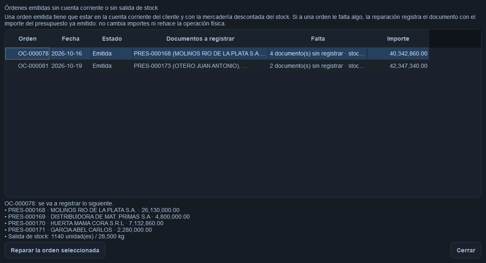

# Issue #726 — Emitir una orden puede dejarla "Emitida" sin cuenta corriente

- **GitHub:** https://github.com/oscarvogel/femag_desktop/issues/726
- **Estado:** implementado en este PR, pendiente de revisión
- **Base auditada:** `origin/main` @ `af43442`
- **Rama:** `fix/issue-726-emision-atomica-cuenta-corriente`
- **Registrado:** 2026-10-19
- **Alcance del incidente:** 2 órdenes de producción (OC-000078 y OC-000081)

## Contexto

Se reportó que una orden de carga **emitida** no aparecía en la cuenta corriente del
cliente. Al verificar contra el dump de producción del 19/10/2026 16:11
(`femag_desktop.sql`) el problema era más grande de lo que decía el reporte:

| Orden | Emitida | Clientes | Movimiento en cuenta corriente | Salida de stock |
|---|---|---|---|---|
| OC-000078 | 19/10 15:44 | 810, 572, 849, 135 | **ninguno** (4 presupuestos huérfanos) | **ninguna** |
| OC-000081 | 19/10 09:51 | 10, 131 | **ninguno** (2 presupuestos huérfanos) | **ninguna** |

Son las **únicas dos** órdenes emitidas o cerradas de todo el historial sin
movimiento: el control sobre las 86 órdenes del dump da exactamente esas dos.
La mercadería salió de la planta, pero no quedó registrada ni en la cuenta
corriente ni en el stock.

## Auditoría del estado real

**Lo que ya existía y se reutilizó (sin tocar):**

- `app/services/budget_service.py:96-129` — `ensure_for_load_order_client`: crea o
  recupera el presupuesto de una orden/cliente/parte.
- `app/services/account_ledger_service.py:22-91` — `generate_for_load_order`: genera
  el movimiento de cuenta corriente **usando el presupuesto como única fuente**
  (`totals_from_persisted_items`).
- `app/services/load_order_stock_service.py:192-226` — `register_dispatch`: descuenta
  el stock, idempotente por índice único.
- `app/services/load_order_service.py:1260-1263` — `_replace_destinations`: borra y
  recrea los renglones de la orden en cada edición.
- `scripts/repair_monetary_integrity.py` — patrón de la herramienta de reparación
  (DRY-RUN por defecto, `--apply` explícito, una unidad por ejecución, idempotente).

**Lo que estaba roto:** la comparación presupuesto/mercadería y la atomicidad de la
emisión.

## Comportamiento actual (defectuoso)

### 1. La comparación se hacía por identidad de renglón

`app/services/budget_service.py:337-364` (antes de este PR):

```python
expected = {row.id: (qty, total) for row in rows}      # renglones de la orden
actual = {item.source_order_product_id: (qty, total)    # items del presupuesto
          for item in budget.items
          if item.source_order_product_id is not None}
return expected == actual
```

`BudgetItem.source_order_product` es una FK a `LoadOrderProduct` con
`on_delete="SET NULL"` (`app/models/budgets.py:62-67`) y **cada edición de la orden
borra y recrea los renglones**. El vínculo del item queda en `NULL` y `actual` queda
vacío, así que la comparación daba "no coincide" **con la mercadería intacta**.

Como el cambio de estado a "Emitida" se persiste **antes** de generar la cuenta
corriente, la orden ya no era editable y el sistema cortaba con error en vez de
rehacer el documento:

> "El presupuesto PRES-000168 no coincide con la mercaderia de la OC-000078. La orden
> ya esta emitida y no se puede corregir sola: anule la orden y genere una nueva."

### 2. La emisión no era atómica

`app/services/load_order_operation_service.py:39-62` (antes de este PR):

```python
self.stock.plan_dispatch(order)                                             # valida
issued = self.load_orders.change_status(order, LoadOrder.STATUS_ISSUED, ...) # estado
self.account_ledger.generate_for_load_order(issued)                         # cuenta corriente
self.stock.register_dispatch(issued)                                        # salida de stock
```

`_change_status` no abre transacción: si fallaba el paso 3 o el 4, la orden
quedaba **"Emitida"** y los dos libros sin registrar. En el `auditlog` de la
OC-000078 no hay ni el `generar` de "Cuenta corriente" ni el `descontar_despacho`
de "Stock": la emisión se cortó después del cambio de estado.

### 3. La secuencia que lo dispara (la de todos los días)

1. Se imprime el presupuesto de la orden **pendiente** (`BudgetPrintService` →
   `ensure_for_load_order`), que crea el presupuesto con los items vinculados a los
   renglones de ese momento.
2. Se **edita** la orden (cambia mercadería, se acomodan pallets, cambia un
   destino). Los renglones se recrean y los items quedan sin vínculo.
3. Se **emite**. La comparación falla, la excepción corta la emisión y la orden
   queda "Emitida" a medias.

Evidencia en el `auditlog` de la OC-000078:

| Momento | Evento |
|---|---|
| 16/10 10:13 | se crean e imprimen los presupuestos 168-171 (orden todavía "Pendiente") |
| 16/10 10:38 - 19/10 15:42 | 9 ediciones (cada una recrea los renglones) |
| 19/10 15:44:10 | última edición: se recrean los renglones 987-990 y las asignaciones de pallet |
| 19/10 15:44:14 | `cambiar estado` → **"Emitida"** |
| 19/10 15:44:14 en adelante | **nada**: ni "Cuenta corriente / generar" ni "Stock / descontar_despacho" |

Lo mismo en la OC-000081 (presupuestos 173-174 el 19/10 08:47, edición 09:51:11,
emisión 09:51:14, nada después).

## Comportamiento implementado

### 1. La comparación se resuelve por contenido

`app/services/budget_service.py:337-371`: se comparan **producto, cantidad e
importe** de cada renglón, con un `Counter` para tolerar renglones repetidos. Ya
no depende del id del renglón de origen, que es un detalle de implementación que se
destruye en cada edición.

El control de #585 sigue vigente: un presupuesto con mercadería realmente distinta
(cantidad o importe cambiados) **no** coincide y la emisión se corta.

### 2. La emisión es una sola operación

`app/services/load_order_operation_service.py:39-70`: el cambio de estado, el
movimiento de cuenta corriente y la salida de stock van en **la misma
transacción**. Si algo falla, la orden vuelve a "Pendiente", no queda registrada en
ningún libro y el error se muestra como antes. La validación de stock sigue
haciéndose **antes** de tocar el estado.

### 3. La reparación es una acción de administración, no un script

La vía normal es la aplicación: en la pantalla **Órdenes de carga** aparece el botón
**"Reparar cta. corriente"**, **sólo para el perfil Administrador**, que abre el
diálogo `LoadOrderLedgerRepairDialog`:



El diálogo:

1. Lista las órdenes emitidas o cerradas que no tienen movimiento en la cuenta
   corriente (o salida de stock), con el detalle de qué documento falta y por
   qué importe.
2. Al seleccionar una, muestra abajo exactamente lo que se va a registrar
   (presupuesto, cliente, importe, kilos).
3. Pide confirmación con ese detalle antes de escribir.
4. Repara en **una sola transacción** y deja rastro en el `AuditLog`.
5. Vuelve a listar: la orden reparada desaparece de la lista.

`scripts/repair_missing_ledger_movements.py` queda como complemento de consola
(DY-RUN por defecto, una orden por ejecución) y usa **exactamente el mismo
servicio**: `LoadOrderLedgerRepairService`.

### Detección: dos formatos de movimiento conviven en la base

La detección tiene que reconocer los dos formatos de movimiento que hay en la base
histórica, o marca como rotas órdenes que están bien:

| Formato | `source_ref` | Vínculo al presupuesto | Desde |
|---|---|---|---|
| Actual | `Budget:<id>` | sí | emisión con presupuesto |
| Legacy | `LoadOrder:<id>` | no | órdenes anteriores a #6xx |

Sin reconocer el legacy, la OC-000031 (cerrada, con sus 7 movimientos en regla)
aparecía como rota. Y el faltante de stock **sólo** se marca si la orden también
perdió la cuenta corriente: las órdenes anteriores al cambio que descuenta la
mercadería al emitir (y no al cerrar) no tienen movimientos de stock por orden, y
marcarlas sería un falso positivo que, al reparar, descontaría dos veces la
mercadería.

Con las dos correcciones, contra el dump de producción la detección da
**exactamente dos órdenes**: la OC-000078 y la OC-000081.

## Impacto económico (medido contra la base real)

Los 6 documentos de las dos órdenes rotas sumaban **$82.690.200,00** de deuda que
**no estaba registrada** en la cuenta corriente:

| Orden | Documento | Cliente | A registrar | Saldo que ve la empresa hoy |
|---|---|---|---|---|
| OC-000078 | PRES-000168 | MOLINOS RIO DE LA PLATA S.A. | 26.130.000,00 | **0,00** |
| OC-000078 | PRES-000169 | DISTRIBUIDORA DE MAT. PRIMAS S.A. | 4.800.000,00 | **0,00** |
| OC-000078 | PRES-000170 | HUERTA MAMA CORA S.R.L. | 7.132.860,00 | **0,00** |
| OC-000078 | PRES-000171 | GARCIA ABEL CARLOS | 2.280.000,00 | **0,00** |
| OC-000081 | PRES-000173 | OTERO JUAN ANTONIO | 37.592.100,00 | 53.217.965,81 |
| OC-000081 | PRES-000174 | COMERCIAL EXPRESS S.R.L. | 4.755.240,00 | **0,00** |

**Cinco de los seis clientes aparecen con saldo $0.** Eso es la forma en que la
plata se pierde: nadie reclama a un cliente que el sistema dice que no debe
nada. La mercadería salió de la planta, se facturó y se entregó, y en la cuenta
corriente no hay nada que reclamar.

**Stock**: 56.000 kg de mercadería que salió de la planta y que el sistema sigue
mostrando como disponible (28.500 kg de la OC-000078; 25.500 kg + 2.000 kg de la
OC-000081).

### Cómo me entero de esto en adelante

1. **En la pantalla**: el botón "Reparar cta. corriente" de la pantalla de órdenes
   lleva el número de órdenes afectadas: **"Reparar cta. corriente (2)"**. Es la
   señal, sin abrir nada.
2. **Con el diálogo**: lista las órdenes, el documento que falta, el cliente y el
   importe, y repara con confirmación.
3. **Como control periódico** (sin escribir nada):

   ```bash
   py -m scripts.repair_missing_ledger_movements --list
   ```

4. **Prevención**: desde #726 la emisión es atómica, así que una orden no puede
   volver a quedar emitida sin registrar. La detección de los puntos 1 a 3 es la
   red de seguridad para lo anterior al arreglo (y para lo que se haya hecho por
   fuera de la aplicación).

## Decisiones tomadas

| Tema | Decisión |
|---|---|
| Comparación presupuesto/mercadería | Por **contenido** (producto, cantidad, importe), no por id de renglón |
| Renglones repetidos | `Counter`: dos renglones iguales cuentan dos, como antes |
| Atomicidad | Estado + cuenta corriente + stock en **una** transacción |
| Validación de stock | Sigue **antes** de tocar el estado (`plan_dispatch`) |
| Error de presupuesto desactualizado | El texto se ajustó: ya no dice "anule la orden" cuando la emisión se revierte sola |
| Importes de la reparación | Salen del **presupuesto persistido**, igual que en la emisión; no se recalcula nada a mano |
| Alcance de la reparación | Sólo órdenes "Emitida" y "Cerrada"; las anuladas no se tocan |
| Herramienta | `LoadOrderLedgerRepairService` (servicio), con pantalla de admin y script de consola encima |
| Quién puede reparar | **Sólo el perfil Administrador**: botón y diálogo bloqueados por permiso |
| Detección de movimientos | Reconoce el formato actual (`Budget:<id>`) y el legacy (`LoadOrder:<id>`) |
| Faltante de stock | Se marca **sólo** si la orden también perdió la cuenta corriente |

## Validaciones ejecutadas

```bash
git diff --check                 # sin salida
python -m compileall -q app      # exit 0
python -m app.main --smoke       # "FEMAG smoke OK"
python -m pytest                 # 1744 passed, 3 skipped
```

Tests nuevos:

- `tests/test_issue_726_partial_issue.py` (10 tests): el mecanismo, la regresión, la
  atomicidad, la comparación y la reparación.
- `tests/test_issue_726_admin_repair_ui.py` (3 tests): la pantalla de administración.

| Test | Qué cubre |
|---|---|
| `test_editar_la_orden_deja_el_presupuesto_sin_vinculo_al_renglon` | El mecanismo: editar la orden rompe el vínculo |
| `test_emitir_tras_editar_deja_el_movimiento_en_cuenta_corriente` | La regresión de la OC-000078 |
| `test_emitir_tras_editar_deja_la_salida_de_stock` | La mercadería sale del stock |
| `test_si_el_movimiento_falla_la_orden_no_queda_emitida` | La atomicidad: el estado también se revierte |
| `test_presupuesto_con_mercaneria_distinta_no_considera_que_coincide` | #585 sigue vigente |
| `test_presupuesto_con_la_misma_mercaneria_coincide_aunque_no_haya_vinculo` | La comparación es por contenido |
| `test_la_reparacion_detecta_la_orden_sin_cuenta_corriente` | Detección |
| `test_la_reparacion_genera_el_movimiento_y_es_idempotente` | Reparación e idempotencia |
| `test_la_reparacion_no_toca_una_orden_sana` | Una orden sana no se toca |
| `test_el_dialogo_de_admin_lista_las_ordenes_sin_cuenta_corriente` | El diálogo lista las órdenes rotas |
| `test_un_usuario_que_no_es_admin_no_puede_reparar` | Sin perfil Administrador no se puede |
| `test_el_boton_de_reparar_solo_lo_ve_el_administrador` | El botón sólo existe para el admin |

**Los tres tests clave fallan sin el fix** (verificado con `git stash` sobre los dos
archivos de servicio): `test_emitir_tras_editar_deja_el_movimiento_en_cuenta_corriente`,
`test_emitir_tras_editar_deja_la_salida_de_stock` y
`test_si_el_movimiento_falla_la_orden_no_queda_emitida`.

> Nota sobre el entorno de test: en SQLite las foreign keys no se fuerzan, así que
> al borrar un renglón el item queda apuntando a un id que SQLite reutiliza, en vez
> de quedar en `NULL`. La fixture `foreign_keys_as_mysql` activa
> `PRAGMA foreign_keys = ON` para reproducir el `SET NULL` de MySQL, y lo restaura
> al terminar.

## Validación contra la base real (MariaDB en WSL)

Dump de producción importado en MariaDB 11.8.6 (WSL) y contrastado con los
servicios reales de la aplicación.

**1. La comparación vieja daba "no coincide" con la mercadería intacta:**

| Presupuesto | Cliente | Total | Vínculos | Comparación VIEJA | Comparación NUEVA |
|---|---|---|---|---|---|
| PRES-000168 | MOLINOS RIO DE LA PLATA S.A. | 26.130.000,00 | `[None]` | **False** | True |
| PRES-000169 | DISTRIBUIDORA DE MAT. PRIMAS S.A. | 4.800.000,00 | `[None]` | **False** | True |
| PRES-000170 | HUERTA MAMA CORA S.R.L. | 7.132.860,00 | `[None]` | **False** | True |
| PRES-000171 | GARCIA ABEL CARLOS | 2.280.000,00 | `[None]` | **False** | True |
| PRES-000173 | OTERO JUAN ANTONIO | 37.592.100,00 | `[None, None]` | **False** | True |
| PRES-000174 | COMERCIAL EXPRESS S.R.L. | 4.755.240,00 | `[None]` | **False** | True |

**2. Con el código viejo la emisión cortaba** con exactamente el error reportado.

**3. La reparación dejó las dos órdenes así:**

| Orden | Movimientos | Despachos | Importe movimiento = importe presupuesto |
|---|---|---|---|
| OC-000078 | 4 (26.130.000,00 / 4.800.000,00 / 7.132.860,00 / 2.280.000,00) | 1 (28.500,000 kg) | sí, en los 4 |
| OC-000081 | 2 (37.592.100,00 / 4.755.240,00) | 2 (25.500,000 + 2.000,000 kg) | sí, en los 2 |

Repetir la reparación **no duplica** nada.

**4. Secuencia completa sobre MariaDB real** (imprimir → editar → emitir), con el
`SET NULL` auténtico de MariaDB:

```
OC-000087 creada (Pendiente)
PRES-000198 total=2.249.100,00  item rengl=991 (vinculado)
   -> se edita la orden
PRES-000198 item rengl=None      -> SET NULL real de MariaDB
   -> se emite
status=Emitida
movimientos en cuenta corriente: 1  (id=843, total=2.249.100,00, ref=Budget:198)
despachos de stock: 1              (id=54, LoadOrder:87:Dispatch:1, 1.500,000 kg)
```

**5. Control global:** después de la reparación, **ninguna** orden emitida o cerrada
queda sin movimiento.

**6. La detección da exactamente dos órdenes** sobre el dump de producción (86
órdenes, 197 presupuestos, 836 movimientos):

```
roto: OC-000078 | 4 documento(s) sin registrar · stock sin descontar (1140 un / 28.500 kg)
roto: OC-000081 | 2 documento(s) sin registrar · stock sin descontar (1220 un / 27.500 kg)
```

Esto no fue gratis: la primera versión de la detección marcaba **61 órdenes** rotas.
Eran falsos positivos por dos motivos que sólo aparecen contra la base real:

1. Las órdenes legacy (1 a 62) tienen sus movimientos con `source_ref =
   'LoadOrder:<id>'` y sin vínculo al presupuesto. La detección ahora reconoce
   ese formato.
2. Las órdenes anteriores al cambio que descuenta la mercadería al emitir no
   tienen movimientos de stock por orden. Marcar el stock ahí era un falso
   positivo que, al reparar, habría descontado dos veces la mercadería.

## Alcance incluido

- Comparación de presupuesto/mercadería por contenido.
- Emisión atómica (estado + cuenta corriente + stock).
- Texto del error de presupuesto desactualizado, ajustado a la nueva realidad.
- **`LoadOrderLedgerRepairService`**: detección y reparación de órdenes emitidas a medias.
- **Pantalla de administración**: botón "Reparar cta. corriente" (sólo Administrador) y
  diálogo con el listado de órdenes rotas, el detalle de lo que se registra y la
  confirmación previa.
- Script de consola como complemento, sobre el mismo servicio.
- Tests de regresión sobre el escenario exacto de producción y tests de la opción de
  administrador.

## Fuera de alcance

- No se cambian importes: el movimiento sigue saliendo del presupuesto.
- No se anula ni se rehace ninguna orden de producción.
- No se tocan los presupuestos ya emitidos a mano: se comparan, no se modifican.
- No se migra la base ni se cambia el esquema.
- No se repara la **relación** `BudgetItem.source_order_product` (sigue en `NULL`
  después de una edición): la comparación ya no la necesita. Queda como mejora
  opcional para otro issue.

## Riesgos

- La emisión pasa a ser atómica: hoy, ante una falla, quedaba "Emitida" a medias;
  después queda "Pendiente" y se puede reintentar. Ningún test dependía del estado
  parcial.
- La comparación por contenido es tan estricta como la anterior por renglón, pero
  tolera que los renglones se recreen: si la mercadería cambió de verdad (cantidad o
  importe), el presupuesto **no** coincide y la emisión se corta, igual que antes.
- La reparación escribe en la base de producción: se ejecuta con copia de base
  previa y con el `--apply` explícito.

## Pendientes (operativos)

1. **Merge** de este PR.
2. **Producción**: abrir la pantalla de órdenes con un usuario Administrador y usar
   el botón **"Reparar cta. corriente"**. El diálogo lista las dos órdenes rotas y
   deja registrarlas con confirmación. (Si se prefiere por consola:
   `py -m scripts.repair_missing_ledger_movements --order 78 --apply` y
   `--order 81 --apply`.)
3. **Control posterior** en la pantalla de cuenta corriente: los clientes
   MOLINOS RIO DE LA PLATA (26.130.000), DISTRIBUIDORA DE MAT. PRIMAS
   (4.800.000), HUERTA MAMA CORA (7.132.860), GARCIA ABEL CARLOS
   (2.280.000), OTERO JUAN ANTONIO (37.592.100) y COMERCIAL EXPRESS
   (4.755.240) tienen que tener sus documentos en la cuenta corriente.
4. **Stock**: verificar que la mercadería de la OC-000078 (28.500 kg) y de la
   OC-000081 (27.500 kg) salió del stock.
5. **Comunicación**: avisar a los cuatro clientes de la OC-000078 y a los dos de la
   OC-000081 que sus documentos ya están en la cuenta corriente.
